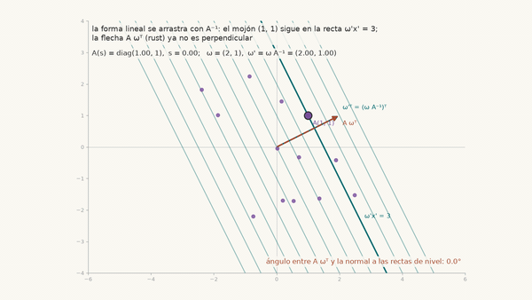
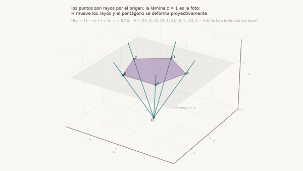
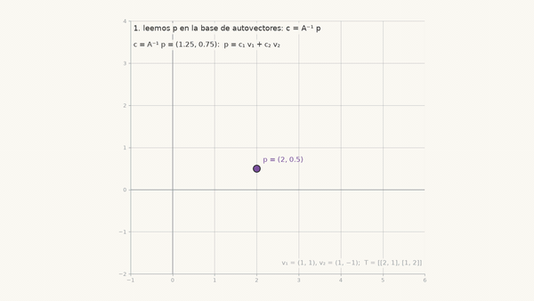
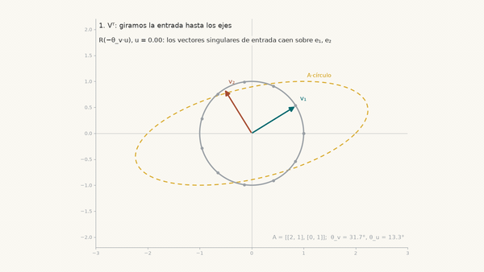
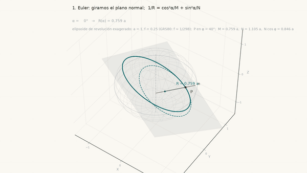
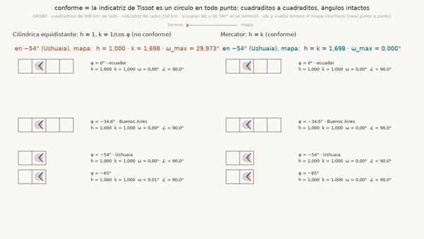

# Curso interactivo — las 20 simulaciones, ladrillo a ladrillo

Este archivo es el mapa directo de las 20 simulaciones de la guía de estudio de CB104 Sistemas de Coordenadas (Agrimensura, FIUBA), en el orden del hilo conductor: cada unidad apoya sobre la anterior y para cada una se listan la clase del esqueleto del profesor que cubre, la pregunta de campo con que arranca, los controles que de verdad tiene el panel, los ejercicios y los enlaces al notebook, a la ficha de clase y al apunte. Lo escribió Gustavo Varela como alumno de la cursada 2C2026 (profesor Javier Clavijo); no es material oficial de la cátedra.
Cada simulación corre adentro del navegador con WebAssembly: no hay que instalar nada ni tener cuenta en ningún lado (la primera carga tarda unos segundos). En una pantalla 16:9 cada sección interactiva muestra la figura a la izquierda y, a la derecha, el panel de controles con el selector de caso, los deslizadores y los números vivos que se recalculan con cada movimiento.
Las seis secciones son siempre las mismas: 0 situación de campo y predicción, 1 hecho geométrico, 2 manipulación, 3 cuenta a mano y código lado a lado, 4 Python de hoy, 5 ejercicios (lápiz y código con hueco, verificado en la página).

## Correr y modificar una simulación en la computadora

Para usar una lección con el Python de la propia computadora (después de clonar el repositorio y correr `uv sync`) alcanzan cuatro comandos:

```
uv run marimo run unidades/08_cambio_de_base.py                          # sólo usar: abre la lección sin mostrar el código y sin tocar el archivo
cp unidades/08_cambio_de_base.py unidades/_ensayo_08.py && uv run marimo edit unidades/_ensayo_08.py   # borrador seguro: se edita la copia
uv run marimo check --select MW unidades/08_cambio_de_base.py            # revisa la unidad editada (0 avisos = bien) y después: uv run python tools/build.py --only 08_cambio_de_base
git checkout -- unidades/08_cambio_de_base.py                            # botón de pánico: descarta los cambios locales de ese archivo
```

El primero proyecta la lección sin tocar el archivo; el segundo hace una copia de borrador (el guion bajo evita que el build la exporte) y la abre para editar; el tercero revisa que una unidad editada no tenga avisos de marimo; el cuarto descarta los cambios locales de un archivo. El paso a paso, con las tres reglas para no romper la exportación, está en la [Parte 3, Paso 4 del instructivo](INSTRUCTIVO_DE_USO.md).

## Unidad 0 — Fundamentos: cuerpos, grupos, puntos, formas lineales y métrica (el idioma de la materia)



*Bucle ida y vuelta: al estirar el Este por 2, los mojones van con A, las marcas de la regla wᵀ van con A⁻¹, el mojón conserva su cota y la flecha ingenua Aw pierde la perpendicularidad.*

Clases del esqueleto: 01, 04 y 09 (desarrollo complementario que las cruza). Pregunta guía: una loma con curvas de nivel circulares se dibuja en un plano con el eje Este estirado por 2; si dibujamos sobre ese plano la flecha de "hacia dónde baja el agua" desde el mojón, ¿para dónde la dibujamos?

**Qué se manipula:**
- Dropdown `objeto`: (a) punto x, (b) regla graduada wᵀ (el gradiente), (c) parche curvo r(u, v), (d) complejo z como matriz.
- Dropdown `A (casos a y b)`: identidad, estirar Este ×2: diag(2, 1), cizalla [[1, 1], [0, 1]], rotación 30°.
- Dropdown `parche (caso c)`: la loma r = (u, v, 2·exp(−(u²+v²)/8)) o un trozo de esfera de radio 2 (φ, λ en grados); deslizadores `u₀ (φ) del punto` y `v₀ (λ) del punto`.
- Dropdown `z (caso d)`: z = i, z = 1 + i, z = 2, z = 0.6 − 0.8i, z = −1.
- Botón reproducir en (a), (b) y (d): de la identidad a la transformación.
- La figura: tres capas, gris antes, teal después, violeta el objeto. En (b) se ven las marcas de la regla arrastradas con la inversa, la flecha perpendicular a las marcas en el papel y la bajada real del terreno (la perpendicular con la métrica). En (c), la grilla tangente del jacobiano y los números E, F, G.

**Ejercicios en Python:** `matriz_complejo(z)` (E1), `arrastrar_punto_y_forma(A, x, w)` (E2), `angulo_g(a, b, g)` y `subida_metrica(w, g)` (E3). Lápiz (a): con la cota h = 3x + y y el Norte estirado por 2, calcular la cota del mojón, el mojón dibujado, la regla arrastrada y decidir si la flecha (3, 1) dibujada en el papel es la subida más empinada. Esta unidad no tiene ejercicio de lápiz (b); los tres de código lo reemplazan.

- Notebook: [unidades/00_desaprender_el_cbc.py](unidades/00_desaprender_el_cbc.py)
- Fichas: [clases/01-rotaciones.md](clases/01-rotaciones.md), [clases/04-espacios-lineales-formas.md](clases/04-espacios-lineales-formas.md), [clases/09-analisis-derivada-jacobiano.md](clases/09-analisis-derivada-jacobiano.md)
- Apunte: [apunte/Apunte_Sistemas_de_Coordenadas.pdf](apunte/Apunte_Sistemas_de_Coordenadas.pdf), secciones "El punto y sus coordenadas no son lo mismo", "Formas lineales: la recta como máquina de medir" y "Métrica y primera forma fundamental".
- [Abrir simulación en el navegador](https://gusvarela-fiuba.github.io/Sistemas-de-Coordenadas/unidades/00_desaprender_el_cbc/index.html)

## Unidad 1 — Rotaciones I: el punto no se movió

Clase del esqueleto: 01. Pregunta guía: el mojón P = (4, 3) de la parcela no se tocó, pero la estación total mide en sus propios ejes, girados 30° respecto de los de la obra; ¿qué coordenadas lee la estación?

**Qué se manipula:**
- Deslizadores `θ (°): giro de los ejes`, `x del mojón (ejes de la obra)`, `y del mojón (ejes de la obra)`.
- Botón reproducir: los ejes giran de 0 a θ.
- La figura: en gris la grilla de la obra; en teal la grilla de la estación (eje x' teal, eje y' rust); en violeta el mojón, que queda clavado, y el camino de lectura cuyos dos tramos son las coordenadas nuevas.

**Ejercicios en Python:** `lectura(p, theta_grados)` (b, código con hueco). Lápiz (a): mojón en (2, 0) y ejes girados 90°, primero con un dibujo y después con la cuenta R(90°)ᵀ(2, 0).

- Notebook: [unidades/01a_punto_quieto.py](unidades/01a_punto_quieto.py)
- Ficha: [clases/01-rotaciones.md](clases/01-rotaciones.md)
- Apunte: [apunte/Apunte_Sistemas_de_Coordenadas.pdf](apunte/Apunte_Sistemas_de_Coordenadas.pdf), secciones "El punto y sus coordenadas no son lo mismo" y "Rotaciones en el plano".
- [Abrir simulación en el navegador](https://gusvarela-fiuba.github.io/Sistemas-de-Coordenadas/unidades/01a_punto_quieto/index.html)

## Unidad 2 — Rotaciones II: la rotación en el plano

Clase del esqueleto: 01. Pregunta guía: para dibujar la parcela con el norte arriba giramos el plano entero un cuarto de vuelta antihorario; el vértice del frente es (4, 1), ¿a dónde va?

**Qué se manipula:**
- Dropdown `caso precargado`: identidad (0°), un cuarto de vuelta (90°), media vuelta (180°), giro de 30°, −90° (horario), y tres contraejemplos que no son rotaciones: espejo diag(1, −1), corte [[1, 0.5], [0, 1]], proyección [[1, 0], [0, 0]].
- Deslizador `θ (°)`, habilitado sólo en las rotaciones; en los contraejemplos la matriz es fija y los números vivos muestran qué falla.
- Botón reproducir: el camino desde la identidad.
- La figura: gris, grilla y cuadrado unitario antes; teal, los mismos después, con las imágenes de e₁ y e₂ como flechas teal y rust (las columnas de la matriz); violeta, la parcela de cinco vértices con estelas en tres de ellos.

**Ejercicios en Python:** `rotar(puntos, theta)` (b, código con hueco). Lápiz (a): qué ángulo lleva (1, 0) a (0, −1), escribir R(θ) con números y buscar otra matriz ortogonal, que no sea rotación, que haga lo mismo.

- Notebook: [unidades/01b_rotacion_plano.py](unidades/01b_rotacion_plano.py)
- Ficha: [clases/01-rotaciones.md](clases/01-rotaciones.md)
- Apunte: [apunte/Apunte_Sistemas_de_Coordenadas.pdf](apunte/Apunte_Sistemas_de_Coordenadas.pdf), secciones "Rotaciones en el plano" y "Rotaciones y números complejos".
- [Abrir simulación en el navegador](https://gusvarela-fiuba.github.io/Sistemas-de-Coordenadas/unidades/01b_rotacion_plano/index.html)

## Unidad 3 — Rotaciones III: tres ejes y el orden importa

Clases del esqueleto: 01 y 02. Pregunta guía: nivelar la estación es inclinar y después girar, y un compañero lo hace al revés; con el punto de prueba e_x = (1, 0, 0), girado 90° alrededor de y y después 90° alrededor de z, ¿dónde termina?

**Qué se manipula:**
- Deslizadores `α (°), alrededor de x`, `β (°), alrededor de y`, `γ (°), alrededor de z`.
- Dropdown `orden de aplicación`: x → y → z (R = Rz·Ry·Rx) o z → y → x (R = Rx·Ry·Rz).
- La figura 3D: el cubo unitario y un terreno de 7×7 puntos, gris antes y teal después; las tres flechas son las columnas de R; en línea de puntos rust, el cubo con el otro orden (la distancia entre los dos cubos es el número vivo que importa); en violeta, el eje de la rotación compuesta. La cámara se mueve con el mouse.

**Ejercicios en Python:** (b) código con hueco sin función: armar R = Rz(90°)·Ry(90°), aplicarla a (1, 0, 0) y verificar con `np.allclose` que u = (−1, 1, 1)/√3 queda fijo. Lápiz (a): escribir Rz(90°) con números, aplicarla a (1, 2, 3) y comprobar que dos veces da diag(−1, −1, 1).

- Notebook: [unidades/01c_rotaciones_3d.py](unidades/01c_rotaciones_3d.py)
- Fichas: [clases/01-rotaciones.md](clases/01-rotaciones.md), [clases/02-mas-rotaciones.md](clases/02-mas-rotaciones.md)
- Apunte: [apunte/Apunte_Sistemas_de_Coordenadas.pdf](apunte/Apunte_Sistemas_de_Coordenadas.pdf), secciones "Rotaciones en tres dimensiones", "Eje de rotación, autovectores y exponencial" y el apéndice "Construcción geométrica de las matrices de rotación 3D".
- [Abrir simulación en el navegador](https://gusvarela-fiuba.github.io/Sistemas-de-Coordenadas/unidades/01c_rotaciones_3d/index.html)

## Unidad 4 — Producto interno: proyección, longitud, ángulo

Clase del esqueleto: 01. Pregunta guía: con tres mojones A, B, C en coordenadas y la línea de base BA, queremos sin volver al campo el ángulo en B y cuánto del lado BC cae sobre la dirección BA (su sombra).

**Qué se manipula:**
- Dropdown `caso precargado`: el triángulo de mojones (v = BC), perpendiculares, paralelos, opuestos, a mano.
- Deslizadores `θ (°): ángulo de v respecto de u` y `|v|`, habilitados sólo en "a mano".
- La figura: u fijo en teal (la línea de base (4, 3)), v en rust, la sombra de v sobre u en gold, el pie de la perpendicular punteado y el arco que marca θ.

**Ejercicios en Python:** `angulo(v, u)` (c) y `proyeccion(v, u)` (d). Lápiz (a): largo y versor de u = (3, 4), si (4, −3) es perpendicular y la sombra de (6, 2); (b): el ángulo en B de tres mojones sin transportador, la distancia AC de dos maneras y qué cambia al girar los tres 90°.

- Notebook: [unidades/02_producto_interno.py](unidades/02_producto_interno.py)
- Ficha: [clases/01-rotaciones.md](clases/01-rotaciones.md)
- Apunte: [apunte/Apunte_Sistemas_de_Coordenadas.pdf](apunte/Apunte_Sistemas_de_Coordenadas.pdf), sección "Producto interno: incidencia".
- [Abrir simulación en el navegador](https://gusvarela-fiuba.github.io/Sistemas-de-Coordenadas/unidades/02_producto_interno/index.html)

## Unidad 5 — Reflexiones y similaridades

Clases del esqueleto: 02 y 03. Pregunta guía: un plano viejo a otra escala y con el norte para otro lado hay que superponerlo sobre el relevamiento nuevo; ¿qué transformación lo hace y con cuántos mojones conocidos alcanza?

**Qué se manipula:**
- Dropdown `caso precargado`: espejo del eje x, espejo de la diagonal y = x, espejo de la recta de ángulo α, dos espejos seguidos (eje x y después recta de ángulo β), similaridad k·R(θ) con centro en el origen, similaridad con centro k·R(θ)x + (3, −2) (la del plano viejo).
- Deslizadores que dependen del caso: `α (°)`, `β (°)`, o el par `k` y `θ (°)`.
- Segundo bloque, trayectorias y líneas coordenadas (clase 2): deslizador `n (repeticiones)`, que repite n veces R(30°), 0.85·I y 0.85·R(30°) sobre un mismo punto y dibuja el círculo, el rayo y la espiral que dejan.
- La figura: gris, grilla y cuadrado unitario antes; teal, los mismos después con las columnas como flechas; violeta, la parcela con estelas. En los espejos se dibuja la recta espejo a rayas; en la similaridad con centro, el centro fijo en gold. El número vivo clave es el área con signo.

**Ejercicios en Python:** `reflexion(alpha)` (c) y `similaridad_por_dos_puntos(P1, P2, Q1, Q2)` (d). Lápiz (a): por qué diag(1, −1) conserva distancias y no es rotación, con un número y con un dibujo; (b): escala, giro y centro de la similaridad z ↦ 2i·z + 1.

- Notebook: [unidades/03_reflexiones_similaridades.py](unidades/03_reflexiones_similaridades.py)
- Fichas: [clases/02-mas-rotaciones.md](clases/02-mas-rotaciones.md), [clases/03-afines.md](clases/03-afines.md)
- Apunte: [apunte/Apunte_Sistemas_de_Coordenadas.pdf](apunte/Apunte_Sistemas_de_Coordenadas.pdf), secciones "Reflejar y componer", "Escalar: homotecias y similaridades" y el bloque "Transformaciones euclídeas y similaridades" con su guía resuelta.
- [Abrir simulación en el navegador](https://gusvarela-fiuba.github.io/Sistemas-de-Coordenadas/unidades/03_reflexiones_similaridades/index.html)

## Unidad 6 — Afinidades y coordenadas homogéneas



*Bucle ida y vuelta: cada vértice del pentágono es un rayo desde el origen que corta la lámina z = 1; H(s) mueve los rayos y el pentágono se deforma sobre la lámina.*

Clase del esqueleto: 03. Pregunta guía: un plano escaneado quedó estirado distinto en cada eje e inclinado; conociendo dónde cayeron las dos esquinas de un lado, ¿dónde tiene que aparecer el mojón intermedio?

**Qué se manipula:**
- Dropdown `caso precargado`: identidad, escala anisótropa diag(1.5, s), corte [[1, s], [0, 1]], reflexión diag(1, −1), rotación + escala 0.8·R(θ), afinidad axial (eje x, dirección (1, 1), factor s), general (a, b, c, d).
- Un deslizador por caso (`s (factor en y)`, `s (corte)`, `θ (°)`, `s (factor)`) y, en "general", los cuatro deslizadores `a =`, `b =`, `c =`, `d =`.
- En la sección 3 (la traslación entra por la tercera columna): deslizadores `θ (°)`, `k (escala)`, `tₓ`, `tᵧ` y radio `orden de composición` (girar, escalar y después mover / mover y después girar y escalar).
- Botón reproducir: el camino desde la identidad.
- La figura: gris y teal, grilla y cuadrado unitario antes y después (la grilla sigue siendo de paralelogramos iguales), con las columnas de A como flechas; violeta, la parcela con estelas; el área se multiplica por det A.

**Ejercicios en Python:** `girar_y_mover(puntos, theta, t)` (c); (d) es un hueco sin función: armar M = [A | t] del escaneo al terreno con tres mojones y ubicar el cuarto. Lápiz (a): imágenes del cuadrado unitario bajo A = [[2, 1], [0, 1]], t = (1, 0), su área y si un escaneo afín puede dar un trapecio; (b): hallar A y t a partir de tres puntos y la imagen de (1, 1).

- Notebook: [unidades/04_afines_homogeneas.py](unidades/04_afines_homogeneas.py)
- Ficha: [clases/03-afines.md](clases/03-afines.md)
- Apunte: [apunte/Apunte_Sistemas_de_Coordenadas.pdf](apunte/Apunte_Sistemas_de_Coordenadas.pdf), secciones "Afinidades: idea geométrica y forma algebraica" y "Coordenadas homogéneas".
- [Abrir simulación en el navegador](https://gusvarela-fiuba.github.io/Sistemas-de-Coordenadas/unidades/04_afines_homogeneas/index.html)

## Unidad 7 — Proyectivas: la foto del dron y el pentágono del profesor


*Bucle ida y vuelta: los rayos desde el origen a los vértices del pentágono se mueven con H(s) y el pentágono sobre la lámina z = 1 se deforma proyectivamente, luego vuelve.*

Clase del esqueleto: 03p. Pregunta guía: en la foto inclinada del dron el lote cuadrado es un trapecio y los alambrados paralelos se juntan; el mojón del centro del lote, ¿dónde aparece en la foto?

**Qué se manipula:**
- Dropdown `caso precargado`: identidad, afinidad (la misma A con última fila (0 0 1)), foto de dron: cámara inclinada (k), pentágono del profesor (A y B fijos, C ↔ E).
- Deslizador `k (inclinación, h₃₂)`, habilitado sólo en el caso del dron.
- Botón reproducir: el camino desde la identidad (en el pentágono, pasando por el espejo).
- La figura: gris, grilla y cuadrado unitario antes; teal, los mismos después (rectas, pero ya no paralelas), con las columnas de H leídas como puntos: las cruces teal y rust son los puntos de fuga, el punto gold es la imagen del origen; violeta, el objeto con estelas.

**Ejercicios en Python:** `aplicar(H, puntos)` (c); (d) es un hueco sin función: la H de la foto al terreno con cuatro mojones (`homografia_4puntos`) y la posición del pozo. Lápiz (a): a dónde van los puntos impropios (1, 0, 0) y (0, 1, 0) con la H de la foto; (b): con la H del pentágono verificar que B queda fijo, calcular H² y la razón doble (D, D'; O, X).

- Notebook: [unidades/05_proyectivas.py](unidades/05_proyectivas.py)
- Ficha: [clases/03p-proyectivas.md](clases/03p-proyectivas.md)
- Apunte: [apunte/Apunte_Sistemas_de_Coordenadas.pdf](apunte/Apunte_Sistemas_de_Coordenadas.pdf), secciones "Homografías: forma algebraica", "Cuatro puntos determinan la homografía" y "El ejercicio del pentágono regular".
- [Abrir simulación en el navegador](https://gusvarela-fiuba.github.io/Sistemas-de-Coordenadas/unidades/05_proyectivas/index.html)

## Unidad 8 — Formas lineales y dualidad


*Bucle ida y vuelta: A(s) = (1−s)I + s·diag(2, 1); las rectas de nivel de ω = (2, 1) se arrastran con A⁻¹, el mojón (1, 1) sigue en ω′x′ = 3 y la flecha Aωᵀ deja de ser perpendicular.*

Clase del esqueleto: 04. Pregunta guía: la cota de un lote inclinado es la fila (2, 1) más una constante; si el plano digitalizado deforma los puntos con A, ¿qué fila sigue leyendo la misma cota sobre el mojón deformado?

**Qué se manipula:**
- Dropdown `caso precargado`: la cota 2x + y sin deformar, giro de 30°, escala anisótropa diag(2, 1), cizalla [[1, 1], [0, 1]], a la base oblicua de 08 (A = B⁻¹).
- Un deslizador por caso: `θ (°)`, `k: factor en x` o `s: corte`.
- Botón reproducir: de la identidad a A, con la regla acompañando a la figura.
- En la sección 4b (desarrollo complementario: una SVM es una forma lineal con margen): radio `deformación A del plano` (identidad, estirar x al doble, cizalla), que deforma dos nubes de mojones y reentrena la divisoria.
- La figura: gris, grilla, parcela y regla antes, más la fila (2, 1) llevada como si fuera un punto (flecha gruesa); teal, la regla después (marca 0 gruesa, valor de cada marca) y la flecha que sí es perpendicular a las marcas nuevas; violeta, la parcela deformada y el mojón con su cota.

**Ejercicios en Python:** `forma_transformada(l, A)` (c) y `recta_por_dos_puntos(p, q)` (d). Lápiz (a): la regla (3, 4): su núcleo, la separación entre marcas, la marca que pasa por (2, 1) y su escritura como combinación de las selectoras x e y; (b): el ejemplo del apunte con A = [[1, 1], [0, 2]], φ = (2, 3), v = (1, 1): cuál de φA y φA⁻¹ es la regla arrastrada.

- Notebook: [unidades/06_formas_lineales.py](unidades/06_formas_lineales.py)
- Ficha: [clases/04-espacios-lineales-formas.md](clases/04-espacios-lineales-formas.md)
- Apunte: [apunte/Apunte_Sistemas_de_Coordenadas.pdf](apunte/Apunte_Sistemas_de_Coordenadas.pdf), sección "Formas lineales: la recta como máquina de medir".
- [Abrir simulación en el navegador](https://gusvarela-fiuba.github.io/Sistemas-de-Coordenadas/unidades/06_formas_lineales/index.html)

## Unidad 9 — Cuña y determinante: el detector de colinealidad

Clase del esqueleto: 05. Pregunta guía: tres mojones de un alambrado que según el título es recto, A = (1, 1), B = (4, 3), C = (7, 6); el detector de colinealidad (B − A) ∧ (C − A), ¿qué número da?

**Qué se manipula:**
- Dropdown `caso precargado`: u = (3, 1), v = (1, 2) (área 5); v gira alrededor de u = (3, 1); v = 2u (colineales, área 0); orden invertido (columnas v, u, área −5); espejo diag(1, −1) (det −1); giro de 40° (det 1).
- Deslizador `ángulo de v (°)`, habilitado sólo en el caso "v gira".
- Botón reproducir: el camino desde la identidad.
- Un piso más arriba, la caja 3D: deslizador `s (posición de w)` que lleva el tercer lado w hasta el plano de u y v y hace bajar el volumen orientado a cero.
- La figura: gris, grilla y cuadrado unitario antes; teal, el cuadrado unitario convertido en el paralelogramo de u y v (flechas teal y rust); violeta, la parcela con estelas, cuya área se multiplica por det M.

**Ejercicios en Python:** `alineados(p, q, r)` (c) y `volumen(u, v, w)` (d). Lápiz (a): la apuesta del pizarrón del 16/9: producto cruz de p y q, producto interno con r, control por el determinante y si están alineados como puntos homogéneos; (b): el área de la parcela después de [[2, 1], [1, 2]], el área con signo después del espejo y qué deja una matriz con det = 0.

- Notebook: [unidades/07a_cuna_determinante.py](unidades/07a_cuna_determinante.py)
- Ficha: [clases/05-subespacios-cuna-determinante.md](clases/05-subespacios-cuna-determinante.md)
- Apunte: [apunte/Apunte_Sistemas_de_Coordenadas.pdf](apunte/Apunte_Sistemas_de_Coordenadas.pdf), secciones "Producto vectorial: unir dos puntos, cortar dos rectas", "Tres puntos alineados: el determinante" y "Producto exterior: la misma idea en cualquier dimensión".
- [Abrir simulación en el navegador](https://gusvarela-fiuba.github.io/Sistemas-de-Coordenadas/unidades/07a_cuna_determinante/index.html)

## Unidad 10 — Núcleo y autovectores: las direcciones que no giran

Clases del esqueleto: 05 y 06. Pregunta guía: un escáner deforma el plano con A = [[2, 1], [1, 2]] y casi todos los rumbos de la parcela giran; ¿cuántos rumbos salen con el mismo rumbo que entraron, estirados o no?

**Qué se manipula:**
- Dropdown `caso precargado`: A = [[2, 1], [1, 2]] (dos direcciones perpendiculares); B = [[3, 1], [0, 2]] (dos direcciones, no perpendiculares); corte [[1, 1], [0, 1]] (una sola dirección); giro de 30° (ninguna dirección real); proyección [[1, 2], [2, 4]] (det 0, el núcleo); homotecia 2I (todas las direcciones).
- Deslizador `rumbo de la flecha de prueba (°)`.
- Botón reproducir: el camino desde la identidad.
- Segundo bloque, el detector sobre A − λI: deslizador `λ`, con la elipse imagen de la circunferencia unitaria y el gráfico de p(λ) = det(A − λI); en λ = 1 y λ = 3 la elipse se aplasta a un segmento.
- La figura: gris, grilla y parcela antes; teal, la grilla deformada con las columnas como flechas; negro a rayas, las direcciones propias con la flecha λ·v̂; violeta, la parcela con estelas y la flecha de prueba (v gris, Av violeta), que no gira sólo sobre una dirección propia.

**Ejercicios en Python:** `nucleo(A)` (c) y `autovectores(A)` (d). Lápiz (a): si B = [[2, 3], [4, 6]] tiene núcleo no trivial, un vector del núcleo y sobre qué recta cae el plano; (b): autovalores y autovectores de [[3, 1], [0, 2]] con el detector y la perpendicular a una fila, y por qué un giro no tiene ninguno.

- Notebook: [unidades/07b_nucleo_autovectores.py](unidades/07b_nucleo_autovectores.py)
- Fichas: [clases/05-subespacios-cuna-determinante.md](clases/05-subespacios-cuna-determinante.md), [clases/06-invariantes-autovectores.md](clases/06-invariantes-autovectores.md)
- Apunte: [apunte/Apunte_Sistemas_de_Coordenadas.pdf](apunte/Apunte_Sistemas_de_Coordenadas.pdf), secciones "Núcleo de una matriz y determinante nulo" y "Autovalores y autovectores".
- [Abrir simulación en el navegador](https://gusvarela-fiuba.github.io/Sistemas-de-Coordenadas/unidades/07b_nucleo_autovectores/index.html)

## Unidad 11 — Autovalores en 3D y puntos fijos proyectivos

Clase del esqueleto: 06. Pregunta guía: nivelar (90° alrededor de y) y después orientar (90° alrededor de z) la estación es un solo giro alrededor de un eje nuevo; ¿qué dirección del espacio deja quieta esa rotación compuesta?

**Qué se manipula:**
- Dropdown `caso precargado`: R_z(θ)·R_y(90°) (una rotación, el eje es su único autovector); reflexión diag(1, 1, −1) (λ = 1 doble y λ = −1); H_c del pentágono de la lección 05 (homología: recta de puntos fijos y centro); giro de 72° alrededor de (2, 1) (un solo punto fijo propio); traslación (1, 2) (el punto fijo es impropio).
- Deslizador `θ de R_z (°)`, habilitado sólo en la rotación.
- Botón reproducir: anima el camino.
- La figura 3D: gris, el cubo unitario antes y el plano z = 1 con el pentágono ABCDE; teal, el cubo después con las columnas como flechas; negro a rayas, las rectas invariantes (autovectores reales) y el rombo donde pinchan z = 1 (el punto fijo); un autovalor doble con cruces nulas da un plano entero de autovectores en gold, que corta z = 1 en una recta de puntos fijos; violeta, el pentágono después, proyectado sobre z = 1.

**Ejercicios en Python:** `eje(R)` (c) y `puntos_fijos(H)` (d). Lápiz (a): autovalores y autovectores de diag(1, −1, 1) por cruz de filas y sus puntos fijos propios e impropios en z = 1; (b): por qué toda proyectiva del plano tiene al menos un punto fijo real y por qué un giro de 72° alrededor de un centro tiene exactamente uno propio.

- Notebook: [unidades/07c_autovalores_3d_puntos_fijos.py](unidades/07c_autovalores_3d_puntos_fijos.py)
- Ficha: [clases/06-invariantes-autovectores.md](clases/06-invariantes-autovectores.md)
- Apunte: [apunte/Apunte_Sistemas_de_Coordenadas.pdf](apunte/Apunte_Sistemas_de_Coordenadas.pdf), secciones "Eje de rotación, autovectores y exponencial" y "Puntos fijos y rectas fijas de una homografía".
- [Abrir simulación en el navegador](https://gusvarela-fiuba.github.io/Sistemas-de-Coordenadas/unidades/07c_autovalores_3d_puntos_fijos/index.html)

## Unidad 12 — Cambio de base y diagonalización



*Bucle ida y vuelta: leemos p en la base de autovectores, estiramos cada dirección propia (λ₁ = 3, λ₂ = 1) y volvemos a la canónica; después se deshace el camino.*

Clase del esqueleto: 08. Pregunta guía: el mismo mojón P = (4, 3) de la obra, medido en frentes y lados de una parcela cuyos rumbos b₁ = (3, 1) y b₂ = (1, 2) forman 45°; ¿cuántas veces b₁ y cuántas b₂ hay que avanzar para llegar a él?

**Qué se manipula:**
- Dropdown `caso precargado`: base girada 30° (Rotaciones I); base oblicua de la parcela; base de autovectores de A = [[2, 1], [1, 2]]; cizalla [[1, 1], [0, 1]] (un solo autovector).
- Deslizadores `giro extra de b₂ (°)` y `factor de largo de b₂`, que desvían b₂ respecto del caso (con b₂ paralelo a b₁ no hay base).
- Bloque de la transformación en su grilla propia: deslizador `n (potencia)` para Aⁿ calculado multiplicando n veces y por BΛⁿB⁻¹, y reproducir para la película de Aᵗ con t de 0 a 1.
- La figura: gris, la grilla de la obra; teal, la grilla oblicua que generan b₁ (teal) y b₂ (rust) con todas sus paralelas; violeta, el mojón quieto y el camino de lectura, cuyos dos tramos son las coordenadas nuevas.

**Ejercicios en Python:** `coordenadas_en(B, p)` (c) y `potencia(A, n)` (d). Lápiz (a): coordenadas de (5, 3) en la base (2, 0), (1, 1) resolviendo Bc = p y por qué proyectar con el producto interno no da lo mismo; (b): diagonalizar [[3, 1], [0, 2]], verificar B⁻¹AB diagonal y calcular A³ por la diagonal.

- Notebook: [unidades/08_cambio_de_base.py](unidades/08_cambio_de_base.py)
- Ficha: [clases/08-cambio-de-base.md](clases/08-cambio-de-base.md)
- Apunte: [apunte/Apunte_Sistemas_de_Coordenadas.pdf](apunte/Apunte_Sistemas_de_Coordenadas.pdf), sección "Cambio de base y diagonalización".
- [Abrir simulación en el navegador](https://gusvarela-fiuba.github.io/Sistemas-de-Coordenadas/unidades/08_cambio_de_base/index.html)

## Unidad 13 — Cambio de base, SVD e inversas



*Bucle ida y vuelta: el círculo unidad con v₁, v₂ pasa por Vᵀ (giro de entrada), Σ (estiramientos) y U (giro de salida); la vuelta deshace las tres etapas.*

Clases del esqueleto: 07 y 10. Pregunta guía: el disco de 1 m de incertidumbre alrededor de un mojón pasa por A = [[2, 1], [0, 1]] y se vuelve la elipse de error; ¿qué le pasa a dos direcciones perpendiculares del disco, si las direcciones propias de A no son perpendiculares entre sí?

**Qué se manipula:**
- Dropdown `caso precargado`: simétrica [[3, 1], [1, 2]]; no simétrica [[2, 1], [0, 1]]; aplastante [[1, 2], [2, 4]] (σ₂ = 0); rotación pura 40° (σ = 1, 1); general (deslizadores).
- Deslizadores `a = A₁₁`, `b = A₁₂`, `c = A₂₁`, `d = A₂₂`, habilitados sólo en "general".
- Botón reproducir: las tres etapas Vᵀ gira, Σ estira, U gira.
- En la sección 3 (los cuatro subespacios en una 3×2): deslizador `tercera medición y₃`, que mueve el tercer punto de una recta por tres puntos y muestra la solución de cuadrados mínimos y el residuo cayendo entero en la contra-imagen (con y₃ = 2 los puntos quedan alineados y el residuo es cero).
- En la sección 4, la SVD sobre el DEM real de la Precordillera de Mendoza (Copernicus GLO-30): deslizador `k (valores singulares que conservo)` y checkbox `Restar altura media antes de truncar`.
- La figura: gris, la grilla antes y el círculo unitario con sus direcciones singulares v₁ (teal) y v₂ (rust); teal, la grilla después; violeta, la elipse imagen con sus semiejes σ₁u₁ y σ₂u₂.

**Ejercicios en Python:** `reconstruir(U, s, Vt, k)` (c) y `pseudoinversa(A, tol=1e-10)` (d). Lápiz (a): calcular AᵀA desde A = UΣVᵀ y explicar por qué los σ² son sus autovalores y nunca complejos; (b): cuándo la pseudoinversa coincide con la inversa, con diag(3, −2) y [[1, 2], [2, 4]] como ejemplos.

- Notebook: [unidades/09_cambio_de_base_svd.py](unidades/09_cambio_de_base_svd.py)
- Fichas: [clases/07-svd.md](clases/07-svd.md), [clases/10-inversas-pseudoinversa.md](clases/10-inversas-pseudoinversa.md)
- Apunte: [apunte/Apunte_Sistemas_de_Coordenadas.pdf](apunte/Apunte_Sistemas_de_Coordenadas.pdf), secciones "Descomposición en valores singulares (SVD)" e "Inversas, los cuatro subespacios y la pseudoinversa".
- [Abrir simulación en el navegador](https://gusvarela-fiuba.github.io/Sistemas-de-Coordenadas/unidades/09_cambio_de_base_svd/index.html)

## Unidad 14 — Jacobiano y primera forma fundamental

Clase del esqueleto: 09. Pregunta guía: sobre el modelo digital de una loma damos el mismo paso de grilla (una unidad en u, nada en v) desde la cima y desde la ladera; ¿cuánto mide ese paso con cinta, sobre el terreno, en cada lugar?

**Qué se manipula:**
- Dropdown `superficie precargada`: la loma r = (u, v, 2·exp(−(u²+v²)/8)); plano inclinado z = 1 + 0.4u + 0.3v; cilindro de radio 1.5 (u ángulo, v altura); esfera de radio 2 (φ latitud, λ longitud).
- Deslizadores del punto y del pasito, con etiquetas que siguen a la superficie: `u del punto` y `v del punto` (o `u (°)`, `φ (°)`, `λ (°)`), y `du`, `dv` (en grados, `du (°)`, `dφ (°)`, `dλ (°)`, cuando la coordenada es angular).
- La figura 3D: gris, la grilla (u, v) plana abajo; teal, la misma grilla levantada sobre la superficie con el plano tangente y los ejes locales r_u (teal) y r_v (rust) saliendo del punto; violeta, el pasito (du, dv) en la grilla, su imagen sobre la superficie y en el plano tangente (punteado). Los números vivos son la tabla E, F, G y el largo del paso por fórmula y con cinta.

**Ejercicios en Python:** `primera_forma(r, u, v)` (c) y `longitud_paso(E, F, G, du, dv)` (d). Lápiz (a): r_u, r_v y la tabla E, F, G del cilindro de radio 10 m, y cuánto mide un paso de 1° en u y de 1 m en v; (b): por qué F = 0 significa ejes locales perpendiculares y a qué ángulo se cruzan sobre el plano inclinado las líneas de la grilla.

- Notebook: [unidades/10_jacobiano_primera_forma.py](unidades/10_jacobiano_primera_forma.py)
- Ficha: [clases/09-analisis-derivada-jacobiano.md](clases/09-analisis-derivada-jacobiano.md)
- Apunte: [apunte/Apunte_Sistemas_de_Coordenadas.pdf](apunte/Apunte_Sistemas_de_Coordenadas.pdf), secciones "Coordenadas curvilíneas y bases locales" y "Métrica y primera forma fundamental".
- [Abrir simulación en el navegador](https://gusvarela-fiuba.github.io/Sistemas-de-Coordenadas/unidades/10_jacobiano_primera_forma/index.html)

## Unidad 15 — Cuatro problemas: regresión, círculos, Procrustes, regresión total

Clase del esqueleto: 11 (anticipación del alumno sobre el esqueleto 2025; pendiente de validar por la cátedra). Pregunta guía: ubicar un poste midiendo con cinta sus distancias a cuatro mojones conocidos, con dos incógnitas y cuatro mediciones con error; ¿qué punto anotamos como posición del poste?

**Qué se manipula:**
- Dropdown `problema`: (a) recta de ajuste y = ax + b por nueve puntos; (b) punto por distancias a cuatro mojones; (c) Procrustes: dos relevamientos del mismo lote; (d) regresión total: error en x y en y.
- Deslizador de ruido, cuya etiqueta cambia con el problema: `ruido en y (m)`, `error de cinta (m)`, `ruido del segundo relevamiento (m)`, `ruido en x y en y (m)`; con ruido 0 la solución es exacta (misma semilla siempre).
- La figura: los datos, la solución de cuadrados mínimos y los residuos punteados, que crecen con el ruido pero siguen repartidos; el número vivo de control es Aᵀr ≈ 0.

**Ejercicios en Python:** `ajustar_recta(xs, ys)` (c) y `punto_por_distancias(M, d)` (d). Lápiz (a): tres mediciones del mismo lado como Ax = y con A la columna de unos, ecuaciones normales, solución y residuo; (b): ajustar y = ax + b por tres puntos y comprobar que el residuo es perpendicular a las dos columnas.

- Notebook: [unidades/11_cuatro_problemas.py](unidades/11_cuatro_problemas.py)
- Ficha: [clases/11-cuatro-problemas.md](clases/11-cuatro-problemas.md)
- Apunte: [apunte/Apunte_Sistemas_de_Coordenadas.pdf](apunte/Apunte_Sistemas_de_Coordenadas.pdf), sección "Guía resuelta de los cuatro problemas (Clase 11)".
- [Abrir simulación en el navegador](https://gusvarela-fiuba.github.io/Sistemas-de-Coordenadas/unidades/11_cuatro_problemas/index.html)

## Unidad 16 — Curvatura como forma cuadrática



*Bucle ida y vuelta: el plano normal gira en acimut (Euler: el círculo osculador entre M y N) y después se inclina hasta el paralelo de radio N cos φ (Meusnier).*

Clase del esqueleto: 12 (anticipación del alumno; pendiente de validar por la cátedra). Pregunta guía: parados en un paso de montaña con el nivel centrado, el terreno cercano es la silla z = (x² − y²)/4; al dar un paso de 1 m, ¿cuánto se aparta el terreno del plano del nivel según el rumbo?

**Qué se manipula:**
- Dropdown `caso precargado`: esfera (cuenco de radio 2.5); cilindro (canaleta de radio 2.5, eje y); silla z = (x² − y²)/4; loma (terreno suave).
- Deslizadores `x₀`, `y₀` (el punto) y `rumbo α (°) desde el eje x`.
- La figura 3D: gris, la superficie con su grilla (x, y) y el plano tangente; gold, la normal; violeta, el rumbo dentro del plano tangente, la sección normal y su círculo osculador de radio 1/κ_n; teal y rust, las direcciones principales (radio mínimo en teal, máximo en rust).

**Ejercicios en Python:** `curvaturas_principales(E, F, G, L, M, N)` (c) y `gauss(E, F, G, L, M, N)` (d). Lápiz (a): para la silla en el origen escribir I y II, las curvaturas principales con sus rumbos, K y los dos rumbos de curvatura normal nula; (b): si puede existir un mapa plano de la Tierra que conserve todas las distancias.

- Notebook: [unidades/12_curvatura.py](unidades/12_curvatura.py)
- Ficha: [clases/12-curvatura.md](clases/12-curvatura.md)
- Apunte: [apunte/Apunte_Sistemas_de_Coordenadas.pdf](apunte/Apunte_Sistemas_de_Coordenadas.pdf), sección "Curvatura: de la curva plana a la forma cuadrática".
- [Abrir simulación en el navegador](https://gusvarela-fiuba.github.io/Sistemas-de-Coordenadas/unidades/12_curvatura/index.html)

## Unidad 17 — Geometría del elipsoide


*Bucle ida y vuelta: el plano normal gira en acimut (Euler, círculo osculador entre M y N) y luego se inclina hasta el paralelo de radio N cos φ (Meusnier).*

Clase del esqueleto: 13 (anticipación del alumno; pendiente de validar por la cátedra). Pregunta guía: un mojón sobre GRS80 con latitud geodésica 45° según el GNSS; la recta del mojón al centro de la Tierra, ¿qué ángulo forma con el plano del ecuador?

**Qué se manipula:**
- Dropdown `caso precargado`: esfera (f = 0); elipsoide exagerado (f = 0.3); elipsoide de juguete a = 5, b = 4; GRS80 (f = 1/298.257).
- Deslizadores `φ geodésica (°)` y `λ (°)`.
- La figura 3D, en unidades de a: gris, el elipsoide con su grilla y la recta al centro; teal, el meridiano del punto; gold, su paralelo; rust, la normal desde el eje polar hasta el punto (el tramo hasta el eje mide exactamente N). Los números vivos (las tres latitudes, M, N, X, Y, Z) usan el a del caso.

**Ejercicios en Python:** `geodesica_a_cartesiana(phi, lam, h)` (c) y `latitud_geocentrica(phi)` (d). Lápiz (a): por qué en el ecuador y en los polos coinciden las tres latitudes, primero sin fórmulas y después con tan ψ = (1 − e²) tan φ; (b): N − M en el ecuador en función de a y e², su valor en metros para GRS80 y cuánto vale en los polos.

- Notebook: [unidades/13_elipsoide.py](unidades/13_elipsoide.py)
- Ficha: [clases/13-elipsoide.md](clases/13-elipsoide.md)
- Apunte: [apunte/Apunte_Sistemas_de_Coordenadas.pdf](apunte/Apunte_Sistemas_de_Coordenadas.pdf), sección "Geometría del elipsoide: latitudes, radios y conversión".
- [Abrir simulación en el navegador](https://gusvarela-fiuba.github.io/Sistemas-de-Coordenadas/unidades/13_elipsoide/index.html)

## Unidad 18 — Trigonometría esférica

Clase del esqueleto: 14 (anticipación del alumno; pendiente de validar por la cátedra). Pregunta guía: una red de tres vértices que no caben en ningún plano, Buenos Aires, Mendoza y Ushuaia, con lados de miles de km sobre la esfera; los tres ángulos medidos en los vértices, ¿cuánto suman?

**Qué se manipula:**
- Dropdown `caso precargado`: octante (tres ángulos rectos); triángulo chico (lados de 1°, casi plano); tres ciudades argentinas; a mano (A y B fijos, C con los deslizadores).
- Deslizadores `latitud de C (°)` y `longitud de C (°)`, habilitados sólo en "a mano".
- La figura 3D: gris, la esfera unitaria; teal, rust y gold, los vectores A, B, C desde el centro con sus latitudes y longitudes; teal grueso, los tres lados como arcos de círculo máximo. Se arrastra para girarla; los números vivos son lados, ángulos, suma y exceso esférico.

**Ejercicios en Python:** `lado(p, q)` (c) y `angulo_esferico(a, b, c)` (d). Lápiz (a): triángulo con b = c = 60° y A = 90°: el lado a, los ángulos B y C por la ley del coseno, la suma, el exceso y qué fracción de la esfera cubre; (b): el exceso esférico de una poligonal triangular de lados de 10 km y de 100 km sobre la Tierra, y si un cuadrilátero esférico puede tener los cuatro ángulos rectos.

- Notebook: [unidades/14_trigonometria_esferica.py](unidades/14_trigonometria_esferica.py)
- Ficha: [clases/14-trigonometria-esferica.md](clases/14-trigonometria-esferica.md)
- Apunte: [apunte/Apunte_Sistemas_de_Coordenadas.pdf](apunte/Apunte_Sistemas_de_Coordenadas.pdf), sección "Polígonos geodésicos y trigonometría esférica".
- [Abrir simulación en el navegador](https://gusvarela-fiuba.github.io/Sistemas-de-Coordenadas/unidades/14_trigonometria_esferica/index.html)

## Unidad 19 — Transformaciones conformes: números complejos, Jacobiano y del elipsoide al plano cartográfico



*Bucle ida y vuelta, lado a lado: a la izquierda la cilíndrica equidistante, no conforme, aplasta los círculos de Tissot y tuerce las visuales a 90°; a la derecha Mercator, con la latitud isométrica, manda cuadraditos a cuadraditos y conserva los círculos y el ángulo.*

Clases del esqueleto: 13 y 14 (desarrollo complementario del alumno que cierra el arco Clase 1 complejos → Clase 3 similaridades → Clase 7 SVD y Tissot → Clase 9 Jacobiano y métrica → Clase 13 elipsoide M, N → Mercator y Gauss-Krüger; pendiente de validar por la cátedra). Pregunta guía: medimos en Tierra del Fuego (φ = −54°) dos visuales a 90°; si volcamos (λ, φ) directo en una hoja cuadriculada, ¿siguen a 90°?

**Qué se manipula:**
- Dropdown `caso`: Mercator conforme (h = k); cilíndrica equidistante (h = 1); cilíndrica equivalente (h·k = 1); mapa complejo (w = z², eᶻ o z + α z̄).
- Deslizadores `latitud φ (°)` (de −75 a 75, por defecto −54), `rumbo α` de una de las visuales y `α` de la parte no conforme en z + α z̄.
- La figura, en dos paneles: a la izquierda el terreno, con la grilla de cuadraditos métricos, los círculos de Tissot en 0°, −34,6°, −54° y −65° y dos visuales a 90°; a la derecha el mapa proyectado, con lo que le pasó a cada cosa. Los números vivos: el Jacobiano, h = σ₁, k = σ₂, h·k, la deformación angular máxima ω_max y el ángulo entre las visuales antes y después.

**Ejercicios en Python:** `es_jacobiano_conforme(J)` (c) y `latitud_isometrica_elipsoide(phi_deg, e)` (d). Lápiz (a): el producto de dos matrices de la forma [[a, −b], [b, a]] vuelve a tener esa forma, así que componer conformes da conforme; (b): la condición de la cilíndrica equivalente (h·k = 1) y por qué conservar áreas obliga a torcer los ángulos.

- Notebook: [unidades/15_transformaciones_conformes.py](unidades/15_transformaciones_conformes.py)
- Fichas: [clases/13-elipsoide.md](clases/13-elipsoide.md), [clases/14-trigonometria-esferica.md](clases/14-trigonometria-esferica.md)
- Apunte: [apunte/Apunte_Sistemas_de_Coordenadas.pdf](apunte/Apunte_Sistemas_de_Coordenadas.pdf), capítulo 10 (Transformaciones conformes) del apunte.
- [Abrir simulación en el navegador](https://gusvarela-fiuba.github.io/Sistemas-de-Coordenadas/unidades/15_transformaciones_conformes/index.html)

## Autoevaluación

Al final de cada unidad hay seis preguntas de opción múltiple para chequear que el ladrillo quedó firme. Las 120 juntas están en `autoevaluacion.html`, con tres maneras de usarlas:

- **Práctica:** elegimos unidad y nivel, y cada respuesta se explica en el momento.
- **Simulacro:** veinte preguntas, una por unidad; la corrección llega al entregar.
- **Evaluación:** treinta preguntas y hasta cuatro intentos, que quedan anotados sólo en nuestro navegador.

Para la cátedra, el mismo banco está como XML de Moodle en `campus/moodle_banco_120_preguntas_cb104.xml`.
